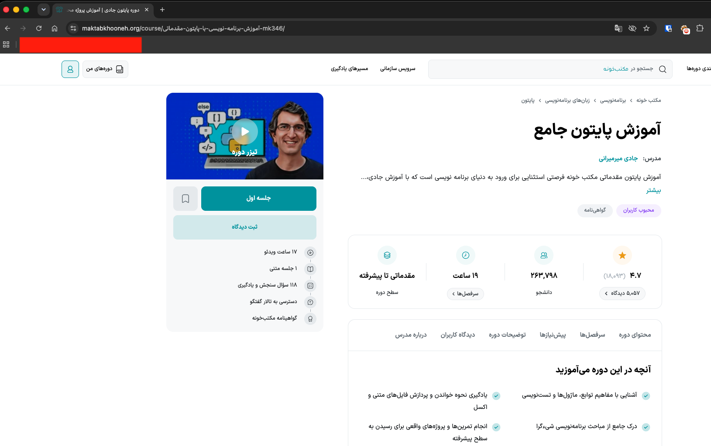
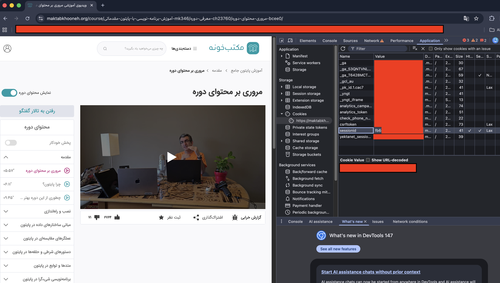

# maktabkhooneh-downloader

Download course unit videos from maktabkhooneh.org using Scrapy.

- **Important (personal use only)**
  - This project is intended **only for personal use** by people who **have a valid maktabkhooneh account** and want to **watch their own purchased/accessible content offline** (e.g., due to unstable internet conditions).
  - **Do not use** this project to share, redistribute, re-upload, or otherwise abuse copyrighted content.

- **Outputs**
  - **Videos**: saved under `downloads/<course_dir>/...`
  - **Metadata**: saved as JSON at `downloads/<course_dir>/output.json`

## Requirements (non-Docker)

- **Python**: 3.13+ (see `pyproject.toml`)
- **uv**: used to install dependencies and run the app

### Install Python (3.13+)

#### macOS

- **Option A (recommended)**: install Python via [python.org](https://www.python.org/downloads/)
- **Option B (Homebrew)**:

```bash
brew install python@3.13
```

#### Windows

1) Install Python from [python.org](https://www.python.org/downloads/)
2) During install, make sure to check **“Add python.exe to PATH”**
3) Open **PowerShell** and verify:

```powershell
python --version
```

#### Linux

- Prefer your distro packages, or use `pyenv` if you need a newer Python than your distro provides.
- Verify:

```bash
python3 --version
```

### Install `uv`

Official installer (works on macOS/Linux/Windows):

```bash
curl -LsSf https://astral.sh/uv/install.sh | sh
```

Then open a new terminal and verify:

```bash
uv --version
```

## Run without Docker (macOS / Linux / Windows)

From the project root:

1) Install dependencies:

```bash
uv sync --frozen
```

2) Run the crawler (interactive prompts):

```bash
uv run python main.py
```

You will be prompted for:
- **Start URL**: a maktabkhooneh course URL, or a unit URL copied from the player (see below)
- **Course folder name (optional)**: becomes `<course_dir>` (it is sanitized to be OS-safe)
- **sessionid (optional, hidden)**: paste your cookie value if the content requires login. If `SESSIONID` is set in `.env`, press Enter to keep it, or type a different value to override it (see below)

## How to choose the Start URL (course URL)

Either of these works. A unit link is rewritten to the course link before the crawl starts.

- Course page: `https://maktabkhooneh.org/course/<slug>/`
- Unit page: `https://maktabkhooneh.org/lms/course/<slug>/unit/<id>/`

The course page is the one that lists units/lessons:



## How to get `sessionid` from Chrome (maktabkhooneh.org)

Some courses require you to be logged in. This crawler can use your login cookie (**`sessionid`**) to access those pages.

1) Open Chrome and sign in to maktabkhooneh.
2) Open the course page.
3) Open **Developer Tools**:
   - macOS: `⌥ Option` + `⌘ Command` + `I`
   - Windows/Linux: `Ctrl` + `Shift` + `I`
4) Go to the **Application** tab.
5) In the left sidebar, go to **Storage → Cookies → `https://maktabkhooneh.org`**
6) Find the cookie named **`sessionid`**
7) Copy its **Value**

You can paste that value when the program asks for `sessionid`, or save it so you can skip the prompt next time:

```bash
cp .env.example .env
```

Put the cookie in `.env`:

```bash
SESSIONID=paste-the-cookie-value-here
```

`.env` is ignored by git. When `SESSIONID` is set, the prompt says you can press Enter to keep it. Typing a new value uses that value for this run only and does not change `.env`.

Docker Compose reads the same `.env` file when it is present.



### Where are files saved?

- **Downloads**: `downloads/<course_dir>/`
- **Feed JSON**: `downloads/<course_dir>/output.json`

### Windows notes

- If you hit build/install issues with native Python dependencies, Docker (below) is the easiest alternative.

## Run with Docker

### Option A: Docker Compose (recommended)

This runs the app with interactive input and mounts `./downloads` so results persist on your host.

```bash
docker compose up --build
```

When it finishes, check:
- `downloads/<course_dir>/` on your host machine

### Option B: Docker CLI

```bash
docker build -t maktabkhooneh-downloader:local .
docker run -it --rm \
  -v "$PWD/downloads:/app/downloads" \
  maktabkhooneh-downloader:local
```

## Troubleshooting

- **Docker error: cannot connect to the Docker daemon**
  - Start Docker Desktop (macOS/Windows) or ensure `dockerd` is running (Linux).
- **403 / blocked responses**
  - This project sets a browser-like `USER_AGENT` in `mk_crawler/settings.py`, but the site may still rate-limit.
  - Try lowering concurrency / increasing delays in `mk_crawler/settings.py`.

